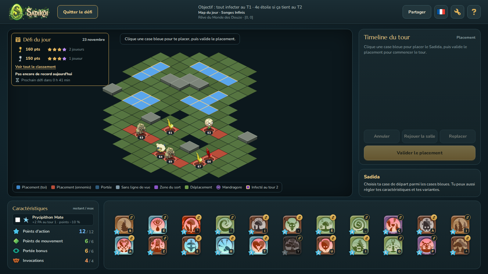

<p align="center">
  <a href="https://sadikoi.app/"></a>
</p>

<p align="center">
  <strong>La salle d'entraînement du Sadida de Dofus 3.</strong><br>
  Entraîne-toi à infecter tous les ennemis dès le premier tour.
</p>

<p align="center">
  <a href="https://sadikoi.app/"><strong>▶ Jouer sur sadikoi.app</strong></a>
  · <a href="https://sadikoi.app/daily">Défi du jour</a>
  · <a href="https://github.com/Nundra/sadikoi/issues">Signaler un bug</a>
</p>

<p align="center">
  🇫🇷 Français · 🇬🇧 <a href="https://sadikoi.app/en">English</a> · 🇪🇸 <a href="https://sadikoi.app/es">Español</a>
</p>

---



## Le principe

Une salle, c'est une vraie map de combat du jeu, des ennemis sur leurs cases de départ et ton Sadida en placement libre. Tu joues **un seul tour** : le tien, puis celui de tes invocations. Pas de dégâts, pas d'IA ennemie : seul compte l'état **Infecté**.

| Résultat | Étoiles |
| --- | --- |
| 100 % des ennemis infectés | ⭐⭐⭐ |
| … et ils le sont encore au tour 2 | ⭐⭐⭐⭐ |
| au moins 75 % | ⭐⭐ |
| au moins 50 % | ⭐ |

À étoiles égales, les **points** départagent : si tout est infecté, chaque PA économisé rapporte ; la Prycipithon Mate coûte 10 %.

## Les modes

- **🏆 Défi du jour** : la même salle pour tout le monde, chaque jour à minuit (heure de Paris), avec un classement anonyme.
- **♾️ Mode infini** : des salles à enchaîner, à 3 étoiles minimum pour passer à la suivante. Jusqu'où iras-tu ?
- **🗺️ Training** : choisis n'importe quelle map (zones, donjons, Songes…) ou une salle de boss, et retravaille-la autant que tu veux.
- **✏️ Créateur de map** : dessine ta propre salle, teste-la et partage-la par un lien.

Chaque salle se partage par un lien court : tes amis jouent exactement la même.

## Fidèle au jeu

- **Les 44 sorts du Sadida** et leurs variantes, avec leurs PA, PO et contraintes au niveau choisi (1 à 200).
- **Toutes les invocations** : poupées, Arbres, Groute, Tréant, chacune avec son propre tour, dans l'ordre du jeu.
- **3 830 maps de combat** extraites du client Dofus 3, avec leurs obstacles et leurs cases de placement.
- **Ligne de vue** calculée comme le client du jeu, **tacle**, **poussées et attirances**, **exploitation de l'état Infecté** (3 fois par tour), durée d'infection de chaque sort…
- **Timeline action par action** : chaque action est vérifiée, montre ce qu'elle change, et s'annule (Ctrl+Z).
- **Barre de sorts façon MMO** : ordre et raccourcis clavier réglables.

Certaines interactions sont une interprétation des descriptions du jeu : si un test en jeu les contredit, [ouvre une issue](https://github.com/Nundra/sadikoi/issues) !

## Sous le capot

| | |
| --- | --- |
| **App** | [Nuxt 4](https://nuxt.com) + TypeScript, SPA statique (`nuxt generate`), [Pinia](https://pinia.vuejs.org), aucune autre dépendance d'exécution |
| **Moteur** | TypeScript pur dans [`engine/`](engine), sans Vue ni DOM, partagé entre le navigateur et le serveur |
| **Tests** | [Vitest](https://vitest.dev) : 95 tests sur le moteur (`pnpm test`), types vérifiés à part (`pnpm typecheck:engine`) |
| **Plateau** | SVG, 14 × 40 cases en quinconce (560), obstacles en dalles isométriques |
| **API** | [Cloudflare Pages Functions](https://developers.cloudflare.com/pages/functions/) ([`functions/api/daily.ts`](functions/api/daily.ts)) |
| **Base** | [Cloudflare D1](https://developers.cloudflare.com/d1/) (SQLite), migrations dans [`migrations/`](migrations) |
| **Données** | extraites du client Dofus 3 et de [dofus-sqlite](https://github.com/ledouxm/dofus-sqlite) par des scripts Python ([`scripts/`](scripts), lancés avec [uv](https://docs.astral.sh/uv/)) |
| **Hébergement** | Cloudflare Pages, déployé à chaque push sur `main` |

### Architecture

```
data/          sorts, maps, rôles d'infection, traductions officielles (JSON extraits du jeu)
engine/        moteur de jeu : règles, grille, ligne de vue, chemins, sorts, score
app/           interface Nuxt : store Pinia, composants, i18n
modules/       module Nuxt qui découpe les maps au build
functions/     API du classement (Pages Functions), qui réutilise engine/
migrations/    schéma D1
scripts/       extraction des données du jeu (Python)
```

### Le moteur

Le moteur ne connaît ni Vue ni le DOM : une partie est un objet simple, et `jouer(partie, action)` rend une nouvelle partie (copie par `structuredClone`) avec un bilan, ou un refus motivé. Le store Pinia ne garde que **la salle et la liste des actions** : la partie est rejouée depuis le début à chaque changement. Annuler, revoir le plateau à une étape de la timeline ou changer une variante en cours de route, c'est donc rejouer la liste, et une action devenue impossible est retirée avec un message.

| Module | Rôle |
| --- | --- |
| [`grille.ts`](engine/grille.ts) | coordonnées en losange (`i = (x + y) / 2`, `j = (x − y) / 2`), distance de Manhattan, voisines, alignements |
| [`ldv.ts`](engine/ldv.ts) | ligne de vue : cases traversées calculées comme le client du jeu (`Dofus2Line`), une ligne qui passe par un coin exact ne compte pas les deux cases qui s'y touchent |
| [`chemins.ts`](engine/chemins.ts) | cases accessibles en PM et plus court chemin, avec des cases d'arrêt (tacle) |
| [`portee.ts`](engine/portee.ts) | cases qu'un sort peut viser (PO min / max, bonus, en ligne, en diagonale, case libre, ligne de vue), avec la raison du refus |
| [`zones.ts`](engine/zones.ts) | zones d'effet : cercle, carré, croix |
| [`mouvements.ts`](engine/mouvements.ts) | poussées, attirances et reculs, direction comme le client du jeu |
| [`sorts.ts`](engine/sorts.ts) | sorts du jeu et table `COMPORTEMENTS` : ce que chaque sort fait pour l'infection |
| [`partie.ts`](engine/partie.ts) | état, actions, ordre des tours (Sadida puis invocations, de la dernière à la première), score |
| [`salle.ts`](engine/salle.ts) | tirage d'une salle et codes de partage (`?salle=…`) |
| [`creation.ts`](engine/creation.ts) | créateur de map et son code de partage compressé (`?carte=…`) |
| [`daily.ts`](engine/daily.ts) | salle du jour tirée de la date, vérification des tours reçus par l'API |

Le moteur ne produit jamais de texte : refus et bilans sont des codes avec paramètres ([`messages.ts`](engine/messages.ts)), mis en phrases par l'interface dans la langue choisie.

### Défi du jour et anti-triche

```
navigateur ── POST /api/daily { placement, sorts, actions } ──▶ Pages Function
                                                                 │ taille ≤ 20 Ko, champs recopiés un à un
                                                                 │ salle du jour retrouvée (fichiers écrits au build)
                                                                 │ tour rejoué par le moteur → score
                                                                 ▼
                                                                D1 (jour, version des règles, score, empreinte du joueur)
```

- Le navigateur n'envoie **jamais son score**, seulement le tour joué. Le serveur le rejoue avec le même moteur et calcule le score lui-même : un tour impossible ou un score inventé ne passent pas.
- La salle du jour vient d'un hasard tiré de la date (heure de Paris). Le serveur fait foi pour le jour et la salle, même si l'horloge du navigateur est fausse.
- Le joueur est une empreinte SHA-256 d'un identifiant aléatoire gardé dans le navigateur : ni compte, ni IP, ni pseudo. Les lignes de plus de 30 jours sont effacées.
- Chaque score est rattaché à une **version des règles** : quand une règle du moteur change, le classement repart de zéro pour cette version.
- Requêtes SQL paramétrées, corps limité à 20 Ko, limite de débit Cloudflare sur `POST /api/daily`, en-têtes de sécurité (CSP stricte, pas d'iframe) dans [`public/_headers`](public/_headers).

### Les données du jeu

| Fichier | Contenu | Produit par |
| --- | --- | --- |
| `data/sorts.json` | 44 sorts du Sadida et ses invocations : PA, PO, rangs par niveau, limites, effets bruts | `scripts/extract-sorts.py` |
| `data/maps.json` | 3 830 maps de combat, 560 cases chacune (marchable, obstacle, vide, placement) | `scripts/extract-maps.py`, depuis les bundles Unity du client |
| `data/traductions/` | noms et descriptions officiels en anglais et en espagnol | `scripts/extract-traductions.py` |
| `public/sorts/`, `public/portraits/`, `public/icones/` | icônes et portraits du jeu | `scripts/extract-icones.py` |
| `data/infection-roles.json` | rôle de chaque sort pour l'infection | écrit à la main |

`data/maps.json` pèse 2,6 Mo : le module [`modules/maps.ts`](modules/maps.ts) le découpe au build en un index léger (environ 55 Ko compressé) et 32 paquets de cases chargés à la demande. Il écrit aussi les fichiers dont l'API a besoin pour retrouver la salle du jour, sans jamais charger toutes les maps.

### Lancer en local

Il faut [Node.js](https://nodejs.org) et [pnpm](https://pnpm.io).

```bash
pnpm install
pnpm dev                 # http://localhost:3000
pnpm test                # tests du moteur
pnpm typecheck:engine    # types du moteur
pnpm generate            # build statique dans .output/public
```

Le classement du défi tourne à part, avec Wrangler et une base D1 locale :

```bash
pnpm dlx wrangler d1 migrations apply sadikoi --local
pnpm generate
pnpm dlx wrangler pages dev --port 8788   # pnpm dev lui passe /api
```

## Vie privée

Pas de compte, pas de cookie, pas de mesure d'audience : tout reste dans le navigateur. Seuls les tours du défi du jour partent au classement, sous un identifiant anonyme tiré au hasard, et sont effacés au bout de 30 jours.

## Contribuer

Les **issues** sont les bienvenues : bug, règle du jeu mal simulée, idée. Les pull requests ne sont pas ouvertes.

## Mentions

Sadikoi est un **projet de fan, gratuit et non affilié à Ankama**. Dofus, ses visuels, ses noms et ses textes appartiennent à [Ankama](https://www.ankama.com) ; ils seront retirés sur simple demande. Voir les [mentions légales](https://sadikoi.app/legals).

Imaginé et dirigé par Jérémie Cieslarczyk. Le code a été écrit avec l'IA [Claude Code](https://claude.com/claude-code) d'Anthropic, sous la supervision de Jérémie, qui a défini les règles du jeu, fait les choix, relu le code et testé en jeu.
