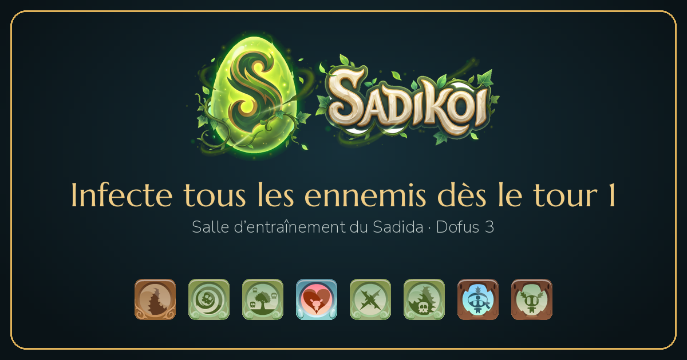

<p align="center">
  <a href="https://sadikoi.app/"></a>
</p>

<p align="center">
  <strong>La salle d'entraînement du Sadida de Dofus 3.</strong><br>
  Entraîne-toi à infecter tous les ennemis dès le premier tour.
</p>

<p align="center">
  <a href="https://sadikoi.app/"><strong>▶ Jouer sur sadikoi.app</strong></a>
  · <a href="https://sadikoi.app/daily">Défi du jour</a>
  · <a href="https://github.com/Nundra/sadikoi/issues">Signaler un bug</a>
</p>

<p align="center">
  🇫🇷 Français · 🇬🇧 <a href="https://sadikoi.app/en">English</a> · 🇪🇸 <a href="https://sadikoi.app/es">Español</a>
</p>

---


## Le principe

Une salle, c'est une vraie map de combat du jeu, des ennemis sur leurs cases de départ et ton Sadida en placement libre. Tu joues **un seul tour** : le tien, puis celui de tes invocations. Pas de dégâts, pas d'IA ennemie : seul compte l'état **Infecté**.

| Résultat | Étoiles |
| --- | --- |
| 100 % des ennemis infectés | ⭐⭐⭐ |
| … et ils le sont encore au tour 2 | ⭐⭐⭐⭐ |
| au moins 75 % | ⭐⭐ |
| au moins 50 % | ⭐ |

À étoiles égales, les **points** départagent : si tout est infecté, chaque PA économisé rapporte ; la Prycipithon Mate coûte 10 %.

## Les modes

- **🏆 Défi du jour** : la même salle pour tout le monde, chaque jour à minuit (heure de Paris), avec un classement anonyme.
- **♾️ Mode infini** : des salles à enchaîner, à 3 étoiles minimum pour passer à la suivante. Jusqu'où iras-tu ?
- **🗺️ Training** : choisis n'importe quelle map (zones, donjons, Songes…) ou une salle de boss, et retravaille-la autant que tu veux.
- **✏️ Créateur de map** : dessine ta propre salle, teste-la et partage-la par un lien.

Chaque salle se partage par un lien court : tes amis jouent exactement la même.

## Fidèle au jeu

- **Les 44 sorts du Sadida** et leurs variantes, avec leurs PA, PO et contraintes au niveau choisi (1 à 200).
- **Toutes les invocations** : poupées, Arbres, Groute, Tréant, chacune avec son propre tour, dans l'ordre du jeu.
- **3 830 maps de combat** extraites du client Dofus 3, avec leurs obstacles et leurs cases de placement.
- **Ligne de vue** calculée comme le client du jeu, **tacle**, **poussées et attirances**, **exploitation de l'état Infecté** (3 fois par tour), durée d'infection de chaque sort…
- **Timeline action par action** : chaque action est vérifiée, montre ce qu'elle change, et s'annule (Ctrl+Z).
- **Barre de sorts façon MMO** : ordre et raccourcis clavier réglables.

Certaines interactions sont une interprétation des descriptions du jeu : si un test en jeu les contredit, [ouvre une issue](https://github.com/Nundra/sadikoi/issues) !

## Sous le capot

| | |
| --- | --- |
| **App** | [Nuxt 4](https://nuxt.com) + TypeScript, SPA statique, [Pinia](https://pinia.vuejs.org) |
| **Moteur** | TypeScript pur dans [`engine/`](engine), sans Vue, testé avec [Vitest](https://vitest.dev) |
| **Plateau** | SVG, 560 cases en losange |
| **Classement** | [Cloudflare Pages Functions](https://developers.cloudflare.com/pages/functions/) + [D1](https://developers.cloudflare.com/d1/) : le serveur rejoue chaque tour envoyé pour calculer le score lui-même |
| **Données** | extraites du jeu avec [dofus-sqlite](https://github.com/ledouxm/dofus-sqlite) et des scripts Python ([`scripts/`](scripts)) |
| **Langues** | français, anglais, espagnol (noms officiels du jeu) |

### Lancer en local

Il faut [Node.js](https://nodejs.org) et [pnpm](https://pnpm.io).

```bash
pnpm install
pnpm dev          # http://localhost:3000
pnpm test         # tests du moteur
pnpm generate     # build statique dans .output/public
```

Le classement du défi tourne à part, avec Wrangler et une base D1 locale :

```bash
pnpm dlx wrangler d1 migrations apply sadikoi --local
pnpm generate
pnpm dlx wrangler pages dev --port 8788   # pnpm dev lui passe /api
```

## Vie privée

Pas de compte, pas de cookie, pas de mesure d'audience : tout reste dans le navigateur. Seuls les tours du défi du jour partent au classement, sous un identifiant anonyme tiré au hasard, et sont effacés au bout de 30 jours.

## Contribuer

Les **issues** sont les bienvenues : bug, règle du jeu mal simulée, idée. Les pull requests ne sont pas ouvertes.

## Mentions

Sadikoi est un **projet de fan, gratuit et non affilié à Ankama**. Dofus, ses visuels, ses noms et ses textes appartiennent à [Ankama](https://www.ankama.com) ; ils seront retirés sur simple demande. Voir les [mentions légales](https://sadikoi.app/legals).

Conçu et codé par Jérémie Cieslarczyk.
